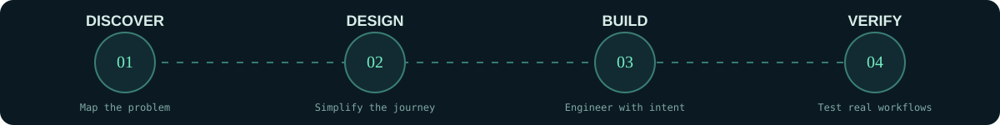

<!-- Original profile design for @aranacj. Assets live in this repository. -->
<div align="center">



<br />

<a href="https://github.com/aranacj?tab=repositories"></a>
<a href="https://github.com/aranacj/claude-world-class-app-team"></a>
<a href="https://github.com/aranacj"></a>

</div>

<br />

## `> whoami`

```ts
const christian = {
  focus: ["Product engineering", "Connected workflows", "System design"],
  philosophy: "Powerful software should feel simple to use.",
  building: "Tools that remove friction from real-world work",
  approach: "Discover → Design → Build → Verify",
};
```

I build software around **how people actually work**—making complex operational tools easier to navigate, understand, and trust. My interests span product experience, system architecture, and AI-assisted engineering workflows.

## `> selected_projects`

<table>
<tr>
<td width="50%" valign="top">

### 🏘️ Property Management Platform

**OPERATIONS · PRODUCT DESIGN · TYPESCRIPT**

An integrated platform covering leasing, applications, move-ins, maintenance, inspections, communications, and day-to-day property operations.

**Design challenge:** Connect related workflows so users can move naturally from one task to the next.

<sub>Private project · Overview only; source code is not public.</sub>

</td>
<td width="50%" valign="top">

### 🤖 [Claude World-Class App Team](https://github.com/aranacj/claude-world-class-app-team)

**DEVELOPER TOOLS · AI WORKFLOWS · QUALITY**

A coordinated toolkit of Claude Code skills and specialist agents for discovery, architecture, UX, implementation, QA, and code review.

**Design challenge:** Bring repeatability and clear decision-making to AI-assisted software development.

[**View the public repository ↗**](https://github.com/aranacj/claude-world-class-app-team)

</td>
</tr>
</table>

## `> how_i_build`

<div align="center"></div>

## `> toolbox`

<div align="center">


<br />


</div>

## `> activity`

<div align="center">

<a href="https://github.com/aranacj?tab=overview"></a>

<sub>Charts use third-party services and represent public activity; private work may not appear.</sub>

</div>

---

<div align="center">

**BUILD THOUGHTFULLY. MAKE THE COMPLEX FEEL SIMPLE.**

<sub>Christian Jay · <a href="https://github.com/aranacj">@aranacj</a> · Made for this profile, not copied from a template.</sub>

</div>
